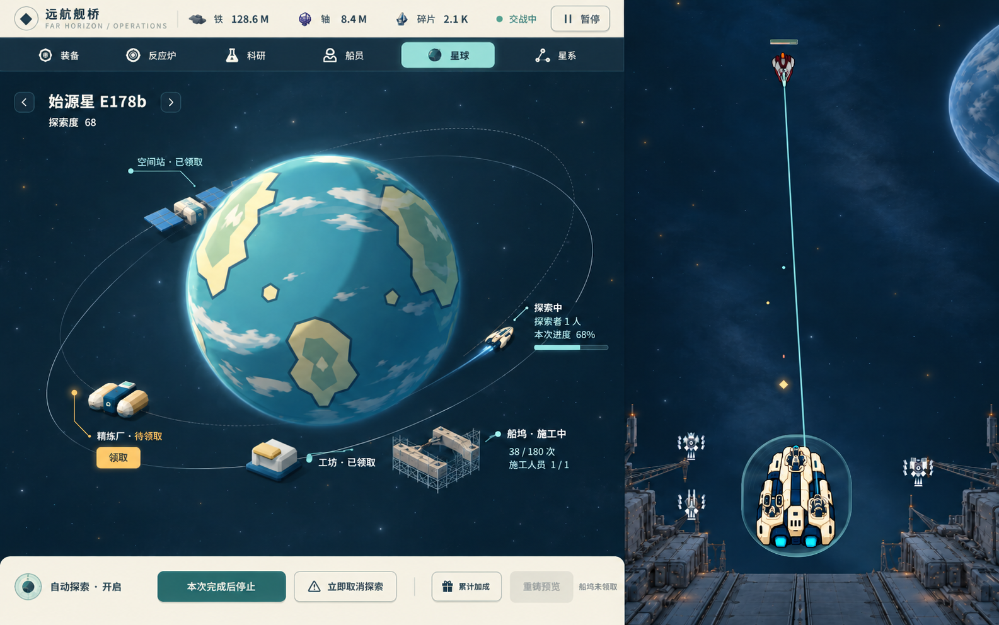
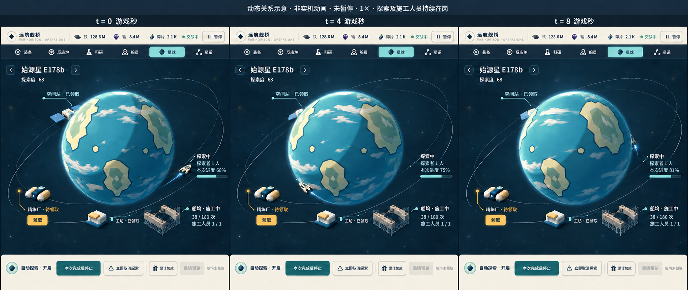

# 星球图稿候选 P2

从[唯一入口](../../game-design/README.md)进入。构图方向经根线程及原独审核对后进入image出图；**本目录图像尚待原独审和用户确认**。不选定2D/3D技术路线，不实施UI，不合main。

[主图原图](main.png) · [三时刻动态关系原图](temporal-storyboard.png) · [方向依据](../planet-history-analysis/next-image-direction.md) · [来源与自查](review-notes.md) · [原始请求](generation-requests.json) · [尺寸/哈希](manifest.json)

本轮将轨道场景铺至模块边缘，补齐前后关系、探索机、四种设施及施工/待领区别；云层、地表与固定光照分别作为动态设计职责，不把生成合成图当运行底图。图中为同一构造样例：始源星D68，空间站/工坊已领取，精炼厂待领，船坞38/180次、施工人员1/1，探索者1人。

分镜t=0/4/8是**未暂停、探索及额外施工人员持续在岗的游戏秒**，1×时等同墙钟秒。本次60秒，进度68%→约75%→约81%；8秒内未完成，故D68和38/180不变。分镜只说明设计，不是实机动画、计算/推进证据或精确相位渲染。

图像工具原图未后期缩放、裁切或拼接：主图1585×992，分镜1930×815。目标工作画布为待确认的1440×900客户区、808×900左模块；**主图实际分界约x=990，映射至1440宽约899px，比808多约91px，精确比例未通过**。分镜是同场景/同视向的生成示意，存在主图与附图尺度/局部位置漂移，不能称逐像素同机位复现；不为细小云层差速反复重画。这些限制交独审判定，不隐去或冒称达标。

上一稿P1保留在其固定提交中，用户已否定其方向；P2不把P1的旧认可说明作为本轮验收。
