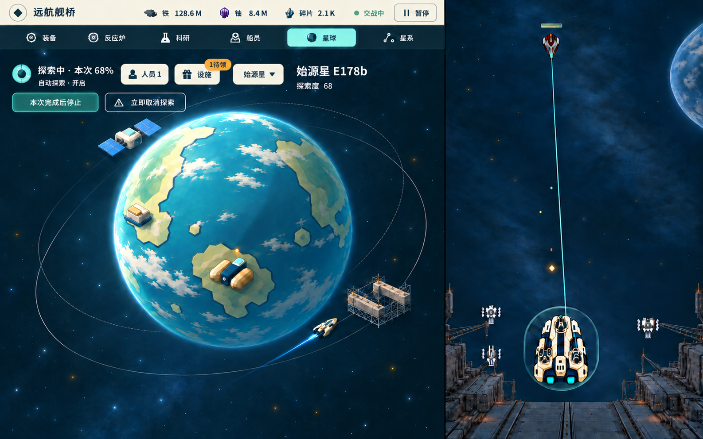
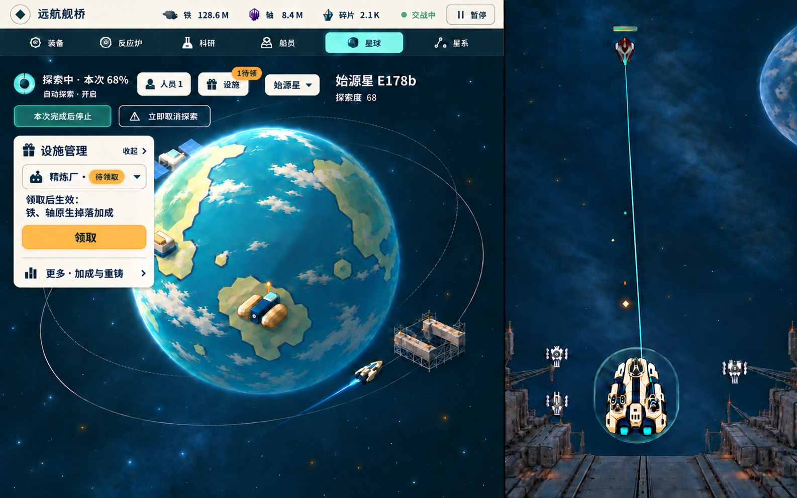

# 星球 P5：左侧集中操作与同侧抽屉

[唯一入口](../../game-design/README.md) → [M7候选规范](../../game-design/art/modules/planet.md)。用户已确认集中方向；本轮基于dbd70b29的观看场景重新设计两态，**图像仍待原独审及用户确认**。不实施UI，不选渲染路线或合main。

[默认观看态原图](default-watch.png) · [左侧抽屉原图](left-drawer.png) · [布局及净空策略](layout-and-clearance.md) · [来源/实看自查](review-notes.md) · [原始请求](generation-requests.json) · [尺寸/哈希](manifest.json)

星球选择、探索摘要、人员、设施/待领入口与停止/取消收在左上同一操作簇；右侧原设施入口和两枚切星箭头均移除，名称/探索度只作身份信息。选择器在两态的同一操作排位置，抽屉不遮它或停止/取消。左侧抽屉保留精炼厂作用、领取及低权重更多入口，不恢复大表或底栏。

沿用同一D68、本次68%、探索者1人及自动开启样例，未推进或领取。空间站轨道、精炼厂贴地、建筑仅观看/操作独立的已定分工保持；工坊贴地、船坞近轨仍是建议。P4观看资产/构图为参照，不宣称生成图逐像素保持原世界。

P5最初三次image_gen完成默认/展开及一次站体/抽屉校正；本次仅新增两态的对象选择最小修订，原两图留drafts作为输入。累计五次，原始PNG未经额外压缩、缩放、裁切或拼接。两张候选均1586×992，分区仍映射约910而非808；控制簇和抽屉也宽于最初预算，808下需保留字号重排，不能整体缩图。新选择器处于两态同一逻辑位置，生成像素仍有数像素差异，不记精确对齐通过。

**净空待审：** 默认站体未压在常用按钮上，但取消按钮靠近轨道上沿；完整运动/抵达包络未验证。展开抽屉允许临时遮部分站体/左球缘，常用控制保持可达。一次修正后站体相对默认图仍有向右生成漂移，不能据此证明原站体的真实遮挡或精确同状态复现。详见自查，不宣称V0/V7通过。
