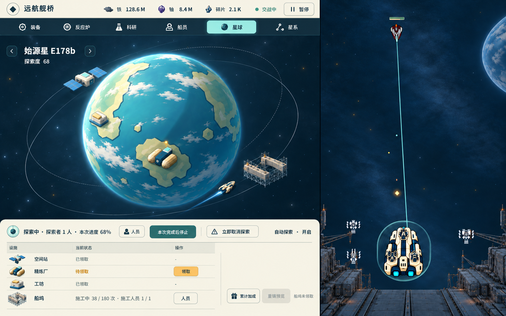
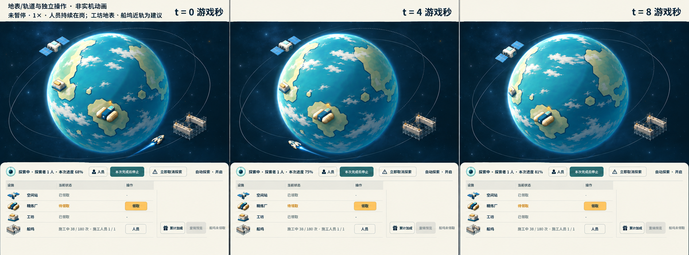

# 星球图稿候选 P3：地表、轨道与独立操作

从[唯一入口](../../game-design/README.md)及[M7候选规范](../../game-design/art/modules/planet.md)进入。按用户新分工生成，**图像待原独审与用户确认**；不实施UI、不选定渲染路线、不合main。

[主图原图](main.png) · [三时刻设计示意](temporal-storyboard.png) · [方向及路线成本](direction-and-routes.md) · [来源/自查](review-notes.md) · [生成请求](generation-requests.json) · [尺寸/哈希](manifest.json)

**用户已定：** 空间站在轨道绕转，资源工厂（精炼厂）在表面；建筑仅供观看和状态表现，操作独立在稳定控制区，不需要点击建筑。

**本轮建议，未由用户选定：** 工坊贴地、船坞近轨固定停靠。图中采用这两个建议供审阅，不能据此称全部设施归属已定。

图中精炼厂与工坊跟随各自大陆改变位置/朝向和球缘压缩，空间站独立运动；任务、设施四行状态、领取/人员等按钮留在同一块固定观察台。场景无建筑点击圈、追踪动作或浮动详情，球体无内嵌卡片框。M7本轮仅总结已定表现/交互和待定边界，共用13未改。

t=0/4/8为未暂停、探索及额外施工人员持续在岗的游戏秒，1×等同墙钟。60秒本次进度68/约75/约81；期间未完成，D68、船坞38/180、额外人员1/1不变。分镜是生成设计说明，不是实机动画或精确相位渲染。

原图未经后期缩放/裁切/拼接：主图1586×992，分镜2057×764。目标工作画布仍为待确认的1440×900/808×900模块；主图实际分界约x1002，映射至1440宽约910px，偏宽约102px，**精确分区未通过**。分镜为同场景视向的近似示意，尺度、地貌/设施贴附和局部位置仍有生成漂移，不记为同机位/动态验收通过。已如实记录，不以代码改图或重复几何重画掩盖。
