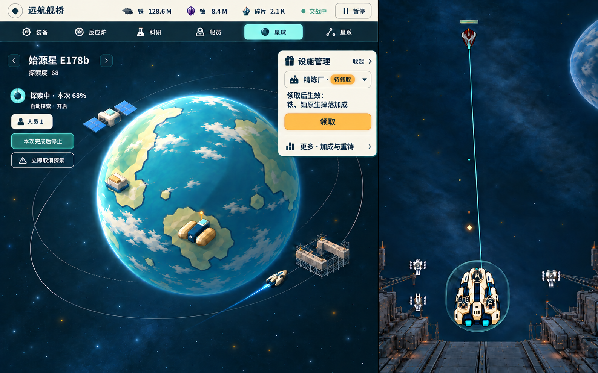

# 星球图稿 P4：默认观看与按需抽屉

[唯一入口](../../game-design/README.md) → [M7候选规范](../../game-design/art/modules/planet.md)。用户要求优先利用圆形星球两侧余量，设施低频管理用抽屉；P3常驻大底部控制区不再沿用。**默认观看方向经根线程/独审认可，原图保留不动；本次只精简抽屉，待复核及用户确认**，不实施UI或合main。

[默认观看态原图](default-watch.png) · [抽屉展开态原图](facility-drawer.png) · [生成前比例/取舍](layout-tradeoffs.md) · [来源/自查](review-notes.md) · [原始请求](generation-requests.json) · [尺寸/哈希](manifest.json)

默认态移除整片底部控制台和常驻设施表：左侧圆外余量放当前探索、人员、自动及停止/取消，右上只留“设施管理／1待领取”。下缘归还轨道空间，不给收起的管理区留空。精简抽屉将“精炼厂·待领取”合并，突出“领取后生效：铁、铀原生掉落加成”和领取按钮；累计加成/重铸收进低权重“更多”入口，去掉常驻禁用块及冗余5/5次数。管理先展开一次，待领入口仍可发现。

两图是同一示例状态的开合设计：D68、本次68%、探索者1人、自动开启；空间站/工坊built、精炼厂ready且施工5/5、船坞38/180和额外人员1/1。未执行领取或时间推进。建筑继续纯观看，精炼厂贴地、空间站独立轨道；工坊地表及船坞近轨仍是建议，未由用户选定。

P4累计三次image_gen输出均已实际查看，本次仅新增一次抽屉精简。默认图SHA-256保持95bc6e14…，与0cf4be88逐字节一致；旧展开图在drafts留作本次生成输入。PNG原始字节归档，**没有额外压缩、缩放、裁切或拼接**。当前两图均1586×992，实际模块分界约x1002，映射至1440宽约910px，仍未达到808目标；新抽屉约260×281原生像素（映射约236×255），较旧版约260×378明显缩短。临时展开允许适度覆盖球缘/后轨道，不声称完全无遮挡。目标808宽下需保留字号重排控件/换行及锚点，不能整体压缩此原图充当适配。原图不证明精确比例、运动净空或V0/V7通过。
