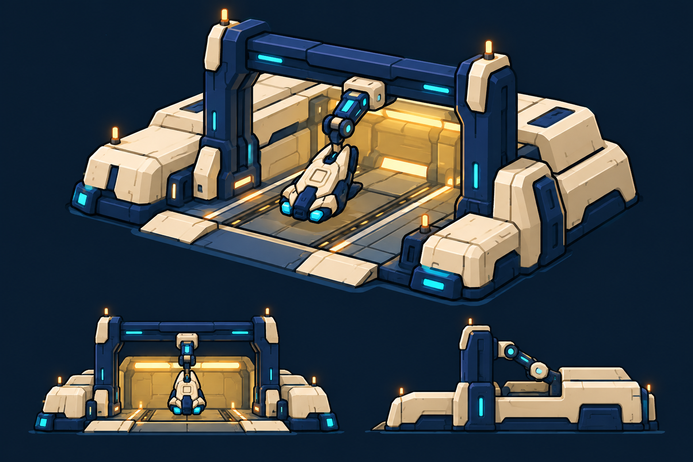
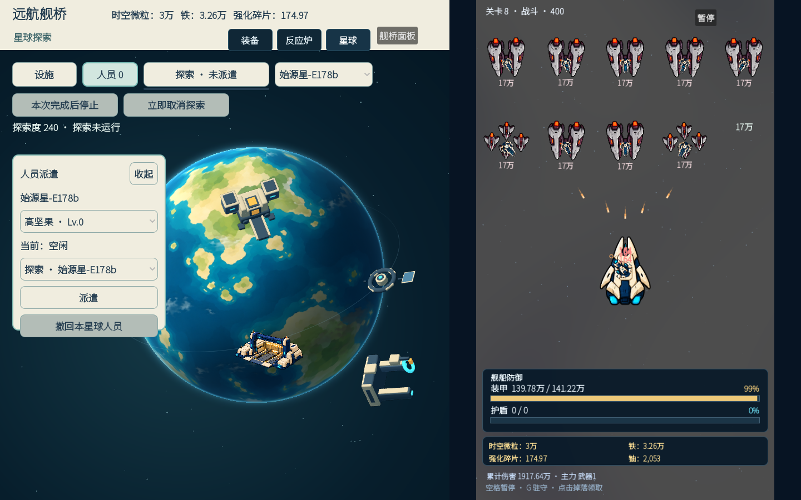

# R8 工坊：分层美术代表单体，交视觉高审

R7 [退回图](../visual-r7/evidence/key_0020.png)里，工坊仍像裸露的盒形门架。此代表候选只改工坊：依据 [R5 认可设计](../visual-r5/designs/workshop.png)制作透明暖象牙/深蓝主体层和独立机械臂层，让两侧斜装甲舱体、粗龙门、深色开放工作湾在实际游戏约 110px 宽度内可读。三张原始 RGBA 图在 `assets/planets/facilities_v5/illustrated/`，其中 `workshop-composite-reference.png` 为画面来源，`workshop-body.png` 与 `workshop-arm.png` 为运行层。主体和机械臂都以未经裁切的透明图挂在原设备 GLB 根和 `ToolArmSweep` 枢轴；仅隐藏工坊旧白模网格。球面 UV 锚点、地表相位、遮挡、接触影、归属和业务均沿用既有运行代码。

| R5 认可方向 | R8 原始实机近侧中段 |
| --- | --- |
|  |  |

上表只用于并排定位；请点开 [原尺寸 `1440×900` 近侧中段](evidence/near-middle.png)判断约 110px 建筑本身，另看 [进入](evidence/near-entry.png)、[离开](evidence/near-exit.png)与 [初始球缘](evidence/initial-built.png)。在这几张原图中，工坊的大轮廓、两侧斜装甲和龙门比 R7 明确；地表随转和球体前后遮挡仍应按画面审查。这是**主形待审候选**，不宣称已满足 R5 细节或用户验收。

[20 秒工坊短周期片段](evidence/workshop-cycle.mp4)由 [20 张相邻原始整屏帧](evidence/frames/)按 1fps 归档，原始采样墙钟 `135.626s` 到 `155.173s`。1fps 不是引擎帧帽，正式场景的时钟、星球转动与战斗正常推进。原 `GantrySlide` 平移；机械臂独立层随 `ToolArmSweep` 作上下工作行程和摆动，不是整栋漂动。[驱动与逐帧轨迹](evidence/driver.gd.txt)、[运行日志](evidence/runtime.txt)、[轨迹数据](evidence/operations.json)均在此。**动作在原尺寸可能仍偏小**，需要高审直接看视频中的臂头姿态，不能用枢轴数值代替。

官方 Godot `4.7.2.stable.official.ed1daf0bf`、本地 native、Xorg `:91`、Mesa llvmpipe 实际主场景。[导入日志](evidence/godot-import.txt)与 [入口脚本检查](evidence/script-check.txt)归档。本页只验证代表工坊，没有给精炼厂/船坞新造型、六星球、整圈净空或 H1 实际挂载背书。证据哈希见 [SHA256SUMS](SHA256SUMS)。
