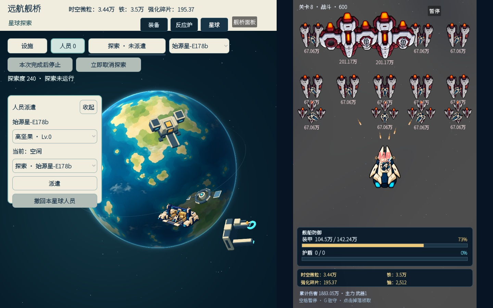
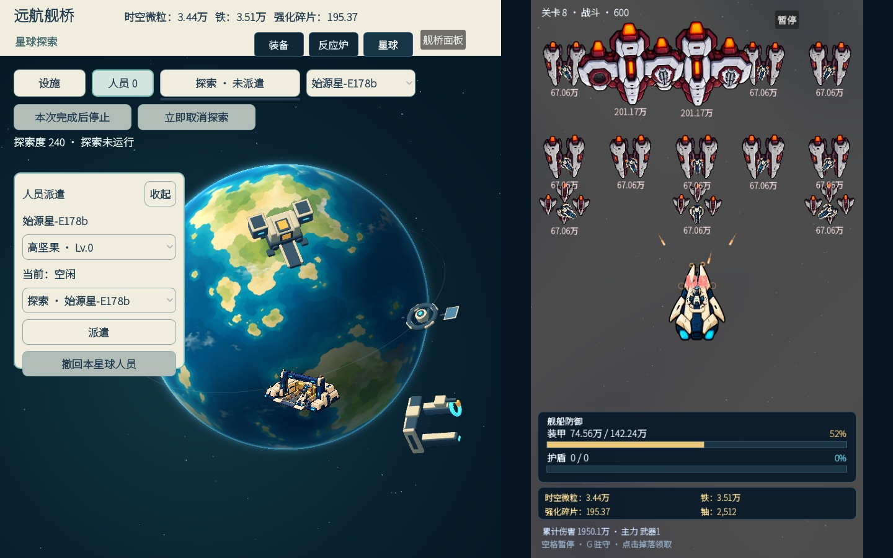
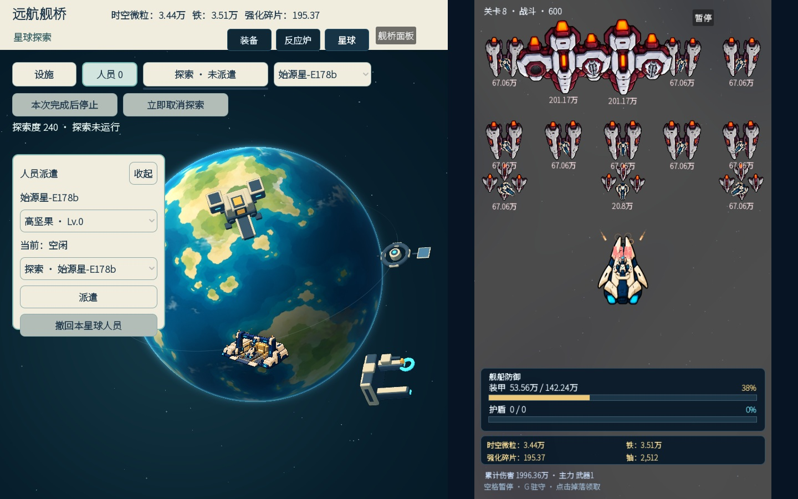

# R9 工坊机械臂层次与工作循环候选

R8 [代表工坊](../visual-r8-workshop/README.md)的主形方向已获独立视觉审认可，但 [原循环片](../visual-r8-workshop/evidence/workshop-cycle.mp4)中第 06、10、13 帧机械臂消失，故动作未通过。本轮只修该问题，不改已认可的工坊主体图、星球贴图、锚点或其他两栋建筑。

原因是原两张 `Sprite3D` 透明层几乎同深；工坊地表切线倾斜时，机械臂沿局部 Y 上下行程会跨过主体的相机深度平面，落到主体不透明像素后面。运行代码现将臂的上下行程投影到相机平面，保持臂层在主体前方固定的模型局部深度，并设置明确的透明绘制优先级。它仍使用原 `ToolArmSweep` 和 `GantrySlide` 枢轴、原球体深度遮挡和游戏时钟。`no_depth_test` 未启用，故不让臂穿球显示。

| R8 丢臂原帧 06 | R9 同机位原帧 06 | R9 原帧 10 | R9 原帧 13 |
| --- | --- | --- | --- |
|  |  |  |  |

[20 秒原尺寸工作循环](evidence/workshop-cycle.mp4)按 [20 张连续 1440×900 实机帧](evidence/frames/)归档；采样墙钟 `135.434–155.031s`，每帧约隔一秒。帧率只指证据视频采样，不是引擎帧帽。逐张实查全部 20 帧，机械臂持续可见并留在工作湾内；[逐帧枢轴和星球相位](evidence/operations.json)记录其两轮约 `1.54–2.24` 模型单位上下行程及 `±0.30` 横向滑座行程。游戏尺寸约 110px，仍请审者以原视频判断动作辨识度，不以数值代替视觉结论。

龙门**横梁是主体图的静态部分**；可见运动的是横梁下的滑座和机械臂。原 `GantrySlide` 数值运动不代表横梁在动。本候选只请求审核机械臂连续可见、相对工作湾的位置和动作可读性；不宣称四建筑、整轨净空或六星球新验证。

真实主场景使用官方 Godot `4.7.2.stable.official.ed1daf0bf`、本地 native、Xorg `:91`、Mesa llvmpipe。主场景启动错误为空，原业务夹具加载成功；[驱动](evidence/driver.gd.txt)、[运行日志](evidence/runtime.txt)、[资源导入日志](evidence/godot-import.txt)、[脚本检查](evidence/script-check.txt)和 [SHA256SUMS](SHA256SUMS)归档。资源重导因先前缓存清理发生，仅恢复取证环境。
