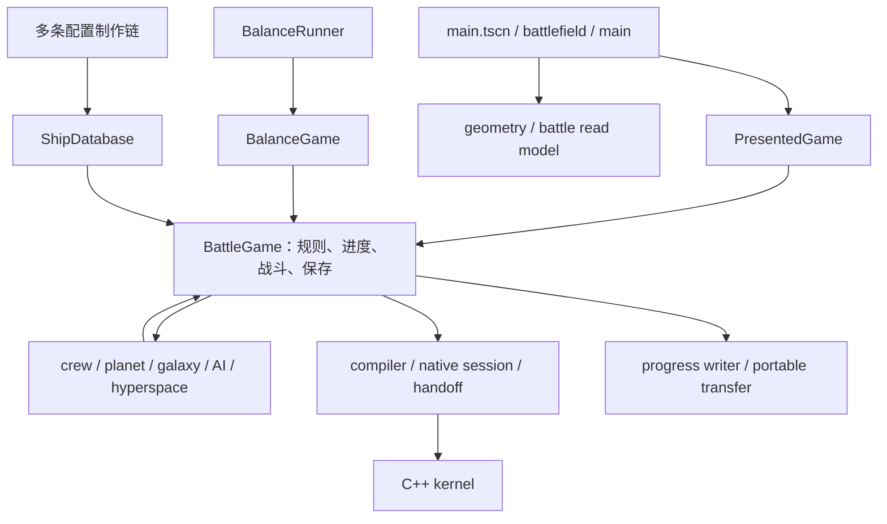

# 独立架构补审：覆盖边界、结构性风险与整理方向

基线：`e3db28386fd0d402f2dc6ae2b2ac4ab7f81674b3`；补审日期：2026-10-20。结论仅针对该提交。本文补充 [原审计报告](REPORT.md)，不替换或修改其 A01—A08、运行结果及环境限制。没有修改产品代码，也没有开始修复。

**不能保证零遗漏。此前的高风险缺陷复现不能代替全项目架构审查，本次文件清点也不能证明所有行为正确。** 本次补足的是：封闭的文件清单、可复算的结构扫描、关键执行与状态边界的人工追踪、明确未审范围，以及可以分阶段验收的整理方案。它仍不是逐行全覆盖或全面安全认证。

## 1. 审计方法与可核查覆盖

采用“固定 Git 树 → 全量文件归类 → 活跃代码结构扫描 → 按职责追踪关键边界 → 对照原运行证据 → 分开报告事实、风险推断和待验证项”的方法。独立判断来自代码与实际证据，不以已有架构文档或通过测试数作为正确性结论。

| 交付物 | 它证明什么 | 它不证明什么 |
|---|---|---|
| [files.csv](architecture/files.csv) | 固定树的 5,223 个文件、blob、大小、类别；没有从样本推算总量 | 所有内容都人工阅读 |
| [coverage.csv](architecture/coverage.csv) | 每个文件的清点/词法扫描状态、模块归组、人工审查范围 | 行、分支或运行覆盖率 |
| [review_scopes.json](architecture/review_scopes.json) | 53 个文件的选定人工阅读职责/函数边界；原缺陷专项阅读见原报告 | 这 53 个文件每行都完成审查 |
| [module_coverage.csv](architecture/module_coverage.csv) | 24 个归组全部落入清单；其他脚本与 UI 未细分的部分显式保留 | 每个模块内部所有规则都验证 |
| symbols/references/event_emissions/state_reference_candidates CSV | 定位函数、字面资源依赖、类名引用、事件及状态候选 | 完整调用图、动态加载图；状态候选也包含读取，不能当作实际写入计数 |
| [boundary_checks.json](architecture/boundary_checks.json) | 打包清单、原生测试准备分支和文档定位的静态交叉核查 | 实际 Windows 发版或原生测试执行 |
| [data_contracts.csv](architecture/data_contracts.csv) | 19 个运行 JSON 的来源/消费者/打包观察，来源未证实者明确标记 | 全部数据值、Excel 公式或最终平衡正确 |
| 原 REPORT 与 evidence 日志 | 原来的 16 组专项执行结果、5 个缺陷探针 | 被导入模块自动具有测试覆盖 |

766 个文件完成词法结构扫描；5,422 个函数声明是扫描输出，不是复杂度或质量评分。分类规则和扫描限制写在脚本内，历史 evidence 中的代码不自动当作活跃实现。二进制素材、工作簿和大量历史证据只完成文件清点。文件总大小为 Git blob 大小之和，不是运行包体或安装大小。

人工审查围绕下列边界，而非随机选择几个 bug：

| 边界/问题 | 已追踪证据 | 尚未完成 |
|---|---|---|
| 实际启动与会话创建 | main.tscn → battlefield → main；PresentedGame 构造与 provider 注入 | Windows 实际启动、所有 UI 交互、GPU 资源生命周期 |
| 核心规则与数值 | Game 聚合、database 数值、reactor/cache；CombatContext/compiled rules；原大数专项 | 每个武器/分支/等级组合、所有浮点误差路径 |
| 进度与配置变更 | crew/planet/AI/galaxy 的代表性命令、guard、失效及事件 | 所有合法调用顺序与中断点 |
| 存档与状态移交 | writer/transfer、主线挂起对象图、native compiler/session/handoff | 全历史版本迁移、所有图形状、全部 IO 故障时序 |
| 多执行路径 | 玩家呈现、实验执行、native 能力和移交、既有对比测试签名 | 全执行器差分运行、Windows native/GPU 行为 |
| 配置制作与发布 | 主表导入、AI 独立导入、实体生成、文本编辑、两个打包器 | 所有工作簿单元格、第三方生成链、最终 EXE |
| 验证基础设施 | 通用 runner、原专项证据、native 条件准备及部分断言 | 全测试集执行、准确行/分支覆盖率、CI 全链路 |
| 原生与外围风险 | C++ 注册/精度约束和 kernel configure/advance/handoff 选段；本机文本编辑器入口 | 完整 C++ 内存/线程/UB 审计，全面渗透、依赖漏洞和素材授权审计 |

因此，“全项目覆盖”的准确含义是**全量清点和范围披露，关键架构边界有选定证据**；不是对全部文件内容的完整审计。`not_claimed`、`inventory_only` 以及“其他运行脚本与UI（未细分）”都是明确的剩余范围。

## 2. 实际架构及已有优点

实际启动不是文档简写的 main.tscn → main.gd：场景绑定 `battlefield.gd`，它继承 main，创建 `presented_battle_game.gd`，后者继承 Game，并使用玩家专用数据库投影。其 geometry/provider、read model、native 会话共同决定实际玩家执行路径。



图是人工归纳的主要依赖，不是穷尽调用图。Game 作为一致性聚合本身有合理性；不能仅因为文件大便判定应该拆散。

应保留的设计包括：`compiled_combat_rules.gd` 将配置投影设为只读；`combat_context.gd` 集中触发来源和深度规则；native compiler 明确拒绝不支持的范围，session/handoff 先准备再按 revision 提交；battle read model 和 equipment/AI view model 分离部分显示投影；player database 隔离玩家改动与敌人原始数据；BalanceRunner 留有基线指纹及策略信息；工具有隔离目录、文本编辑乐观版本校验和原子写入。它们降低了风险，但不覆盖所有边界。

## 3. 架构级发现

严重度表示整理优先级，不是声称每项已发生故障。标为“已复现”的证据沿用原报告；新增结论均说明静态依据与推断范围。

### AR01：会话、规则和基础设施对一个可变 Game 聚合的依赖过宽（P2，结构事实与风险推断）

`game.gd` 有 379 个函数，同时持有 profile、战斗对象/队列、缓存、持久化 writer、native 会话及各进度系统。`main.gd` 有 269 个函数；字面/类名扫描得到 main 44 个、game 28 个不同代码依赖目标。这些数字只辅助定位，真正的问题是边界行为：`battlefield.create_battle_game` 既决定执行器又注入场景几何；Game 初始化还装配并验证超空间数据；crew/planet/AI 等接口接受整份 `g`，可触及数据库、缓存、会话、事件和存档。

结果是调用者很难从函数签名判断权限和副作用；创建一个实验 Game 也携带大量与该实验无关的配置依赖。`galaxy_system.prepare_native_advance/prepare_region_refit` 还直接理解 native handoff/配置切换，业务排程与执行后端策略交织。不能据此断言所有循环依赖都是 bug，但新功能的变更影响难以限定。

**方向：**先记录 Game 内状态所有权和命令副作用，再逐步提供配置读取、进度命令、战斗推进、保存、几何查询等窄接口。保留需要原子一致性的聚合；会话装配和平台/执行器选择移到组合入口。优先从无状态投影、配置装配和持久化适配器提取，避免一次拆分核心战斗。验收：代表性 domain 模块可在不实例化 UI/native 的环境验证，接口列出可写状态和产生的事件，原行为对比通过。

### AR02：多种状态契约独立维护，字段归属和往返保证未形成统一核查面（P1，已有故障证据）

持久进度、`save_transfer` 的便携 schema、`hyperspace_main_return` 的悬挂返回状态、`hyperspace_battle_return` 的对象图，以及 native descriptor/handoff 分别维护字段与校验。用途不同，采用不同 schema 是合理的；风险是新增状态无法从一个注册点确认它必须跨越哪些边界。

原 A01 已复现便携导出丢失 productionElapsed、AI 科技及切装状态等字段；A02 证明“JSON 可读”没有等价于“可恢复的进度”，不完整主文件可遮蔽有效备份。另一方面，超空间对象图显式保留 alias、有尺寸与绑定检查，native 移交保护身份及 revision；这些更强约束并未自动延伸到 durable/portable 边界。

**方向：**维护状态契约表：owner、类型/数值域、默认值、版本/迁移、durable/portable/suspended/native/simulation 是否投影及理由。各投影保留独立 schema，从表生成或核对字段，配套往返/拒绝/恢复不变量。验收：新增 profile 字段必须显式声明归属；有效备份不得被结构不完整主文件替代；跨边界后关键进度和对象身份按契约一致。不是把所有状态序列化成一个巨大公共字典。

### AR03：配置变更的失效与执行器切换协议分散（P1，已有故障证据）

`crew_system.assign/changed`、`planet_buildings.activate`、AI 完成处理和 `hyperspace_system.publish` 分别协调 native guard、状态修改、缓存、save_dirty 和事件；Galaxy 另有 pending 时间结算与 refit。`planet_buildings.state(g)` 返回 live Dictionary，Game/profile 又可被外部直接访问。`game._compiled_configuration_event` 以字符串事件触发派生配置更新，多个消费者各自理解事件名及 payload。

A05 的 reactor 升级未使依赖它的攻击缓存失效，是这套协议已出现的具体遗漏。不能把扫描出的状态候选全部当作违规写入，也不主张同步事件本身有错；问题是“哪些变更必须完成哪些步骤”缺少一个强制入口和可检验结果。

**方向：**对影响战斗配置的命令建立统一提交过程：前置能力/移交检查、旧状态待结算时间处理、修改、递增配置 revision、派生缓存更新、持久化脏标记、最后通知 UI。失败需要明确未提交或补偿语义。事件采用集中字段契约，展示消费者只读；不必重写为全局事件总线。验收：跨 crew/planet/reactor/AI/galaxy 的变更测试同时检查快照 revision、缓存值、native 状态与待结算时间，不只检查购买成功。

### AR04：配置来源多样，但发布依赖和来源证明没有统一清单（P1，已有故障证据）

主 `import_workbook.py` 通过 22 个 sheet 映射生成主数据；AI 科技有独立 `import_ai_tech_tree.py`；超空间实体依赖 schema、冻结奖励来源和专门工作簿；文本、视觉、分析策略又有独立 JSON。`config_panel.execute_import` 进入主工作簿操作，不等价于执行所有配置链。数据库构造则直接读取 game_data、ai_tech_tree、equipment_evolution。

A03 已证明 release 固定 12 个 JSON 的清单没有跟随运行依赖更新。没有统一 provenance/产品清单时，“导入成功”“配置正确”“这个产品的依赖齐全”容易被混为一谈。`config_workbooks.incremental_import` 已有源快照及最终目标复核，不能沿用旧文档声称完全没有并发防护。

**方向：**为每个配置产物声明 authoritative source、writer、validator、消费者、生成时机、版本/指纹、需要进入哪些产品。不同类型保留合适的 Excel/JSON 来源，不强行统一格式。验收：干净隔离目录可复算声明的产物；消费者依赖均在产品清单闭包中；手改生成物和陈旧公式缓存明确报错；事务故障后原集合或新集合完整可恢复（A06）。

### AR05：玩家、实验和原生路径的等价性应按能力范围证明（P2，静态差异；没有新增运行不一致结论）

玩家走 PresentedGame 及场景 provider，实验走 BalanceGame，native 又有有限 scope/branch/numeric 支持。`balance_game.stat` 返回 float、`fire` 接收 raw:float，而 Game 对应接口支持 Variant 大数；实验还重写时间和保存行为。因此“继承同一个 Game”或模式叫 exact 不足以证明全部等级/状态等价。

已有 `test_progression_scene_equivalence.gd` 对比场景，native handoff/numeric-range 测试检查移交或拒绝，不能说没有一致性测试。但前者签名仍列 hightechLevels/techPoints/scientists 等旧字段，没有覆盖新增 aiTech 状态；补审未执行这些测试，不能把接口差异直接认定为可见数值错误。

**方向：**定义能力矩阵：模式、数值范围、支持效果、时间语义、随机数消费、暂停/重配/返航/存档行为。对合法交集做固定 seed 的关键检查点差分，对不支持输入检查显式拒绝或已定义回退。把 profile 契约变化和比较签名联动。验收：报告具体覆盖的能力单元及最大误差/身份不变量，未覆盖模式显示 unknown，而不是泛称 exact。

### AR06：开发目录、运行依赖和独立产品清单边界漂移（P1，静态打包闭包缺口）

`battlefield.gd` 直接引用 `res://dev/toon_ship/` 的多种 VFX，说明 dev 目录含生产运行依赖，不能按目录名清理。独立分析器 builder 手写 27 个脚本；对这些脚本的直接字面 `.gd` 依赖检查发现 23 个不在复制表中，包括 game 依赖的 growth_number、AI、galaxy、hyperspace、native session 等，完整名单见 boundary_checks.json。它是静态闭包缺口；未运行 Windows builder，也不声称坏包已经发布。builder 对 SCRIPT ERROR/Parse Error 有失败门禁，应保留。

**方向：**为玩家游戏、分析器、测试工程、原生构建定义独立产品入口和资源清单，校验强制依赖闭包及动态依赖声明。将真正运行用的 dev 资源归属明确，先声明再考虑迁移。不要依据字面扫描的“未引用”删除动态加载素材。验收：从固定 Git 树在空目录构造各产品并导入；没有隐式借用邻近开发目录或个人文件；必要外部工作簿依赖明确写入产品契约。

### AR07：测试能力准备、断言范围和架构定位存在维护缺口（P2，静态证据与原门禁缺陷）

通用 `test/run.py` 对每个测试复制 scripts、data、assets、tools、addons、dev 等，逻辑测试也耦合完整工程导入。native DLL/描述符准备依赖少数测试文件名分支；21 个根目录 native 命名测试中有 17 个不在该分支，且固定树没有实际 `.gdextension` 描述符，只有模板。干净环境下，至少 handoff/numeric_range 等需要扩展的测试不能仅凭通用入口获得同样能力。名字计数不是失败数量，项目可能另有专用 runner；本次没有运行原生测试。

A08 已复现进程返回 0 不一定等于 Godot 无脚本错误。架构定位文档还指向已不存在的 hightech_workshop.gd、描述 progress v4，而实现已为 v5，并简化了实际 battlefield 入口。这些问题增加读者和门禁选择错误入口的概率。

**方向：**建立测试描述表，声明 engine/platform/native/GPU/fixture/timeout、实际 runner 和 oracle。门禁区分 pass、fail、blocked、not_run，校验脚本错误及断言完成标记；不要用计数替代覆盖。为纯逻辑测试准备最小工程，保留完整集成工程。架构文档链接/入口和产品资源闭包可做便宜的静态检查。验收：新检出环境能按清单复现选定测试，缺少平台能力明确 blocked，测试签名随状态契约更新。

## 4. 可执行整理顺序（建议，未实施）

| 阶段 | 工作边界 | 必须拿到的验收证据 |
|---|---|---|
| 0 契约登记 | 明确状态 owner、配置来源、产品和测试能力清单；更新错误定位 | 与固定树对应的清单；未登记项显式 unknown；不改玩法 |
| 1 保住数据与交付 | 优先处理 A01/A02/A03/A06/A08；数值边界 A04/A07 单独限定政策 | 往返/备份恢复、事务故障注入、干净产品导入、门禁误判探针；边界值拒绝或支持政策明确 |
| 2 收紧配置变更 | 用命令提交/revision 统一现有 guard、结算、失效、通知 | reactor/crew/planet/AI/galaxy 重配前后状态和缓存一致；无重复结算/事件 |
| 3 执行路径契约 | 建立能力矩阵及检查点差分；明确实验 float 与大数策略 | 支持范围内的差分证据、不支持范围的拒绝证据、native 移交身份和时序不变量 |
| 4 渐进拆分 | 提取无状态投影、装配、存储、分析器依赖；最小测试工程 | 每步保持相同输入/seed/检查点行为；独立产品依赖闭合；性能基准不退化 |

不建议大规模重写 Game、立即拆成服务、先换语言，或以文件行数作为拆分完成标准。每一步要说明减少了哪种隐式依赖及如何证明行为保持。A04/A07 涉及玩法可达范围和数值政策，实施前应单独确认需求，审计不代替玩法决策。

## 5. 复算、限制与后续补审

在含基线 Git 对象的检出目录执行（仅写指定审计输出目录）：

```sh
python docs/audits/20261020-e3db2838/architecture/inventory.py --repo . --output /tmp/space-idle-architecture-recheck
python docs/audits/20261020-e3db2838/architecture/check_boundaries.py --repo . --output /tmp/space-idle-architecture-recheck
```

结构 CSV/JSON 可复算；人工 review_scopes、module_coverage、data_contracts 是审计记录而非自动语义证明。coverage 的全部路径/blob 应与 files 一一对应。补审没有再跑游戏测试；原报告的 Linux Godot 4.6.3 结果不能替代项目 Windows 4.7.2/native/GPU 验证。补审交付核查仅验证清单、摘要、文档和 Git 范围。

如继续提高保证程度，应优先在锁定 Windows/native 工具链上补多执行路径差分及打包烟测，再补状态迁移/IO 故障矩阵、深度 C++ 审查、数据生成重现和 UI/GPU 长时资源测试；每批明确输入空间与剩余范围。任何新增基线或新功能都需要重新评估影响，本报告不对未来提交或未审路径作保证。
