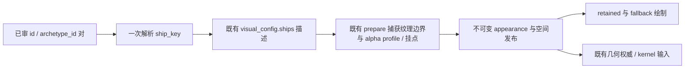

# 身份→R03视觉映射与共享描述最小接法（待父审）

只提案，不挂载ID、不新增敌种、不改碰撞规则或生产资产。当前背景85a04e26与接口核对cc5676f5保留；未合入balance分支，未启动Godot或Windows测试。

权威输入为Sol [fffa4790 FOUR-WEAPON-BUDGET.md 后半](https://github.com/rlmclmc2-boop/space_idle/blob/fffa47902b420a277b21dce98692f6badb569415/test/evidence/weapon-balance-20261015/FOUR-WEAPON-BUDGET.md#minimum-existing-interface-for-astras-presentation-review)。同提交的opening-visual-contract仅补充其既有原型建议；旧18点稿及其数值/摆放不因本提案生效。远端后来有更新，本次按父指定fffa4790审阅，不自动采用后续参数。

## 已闭合的接口事实

- 八对id/archetype_id是**未挂载草案**，两执行器均保留它们；当前41xxx/42xxx/43xxx旧行没有archetype_id，不能按size替它们推定新身份。uid是实例，slot、size、CombatContext.source_id不是敌种。
- Sol分支reactive的hit提供reactive_stacks/reactive_multiplier，可直接表现实际返回值；不从伤害量反推具体免伤量，也不从事件时间接近猜同轮磁轨。此字段尚未合入本表现分支。
- enemy hit.amount含混合损失；absorbed分项不可靠。护盾量/类别从当前敌人读模型取，恢复以实际盾量增长为准，不按计时器假亮。
- fire不保证含shot，原生激光紧凑路径须沿现有绘制/读模型处理。没有可靠的攻击前兆start/end；不新增预测蓄势、危险倒计时或精确窗口条。

## 三个现有母型，八个待审映射

[现有R03图集](../revision-03/enemies-topdown-source.png)从左至右为三角针翼、宽板砧体、开放U形。下表的变体差异是**制作意图，尚未画成八张正式资产**；三张母型不冒充八个已验收身份。名称仅为审稿标签，不注册新运行visual key。

| Sol草案对（未批准挂载） | R03母型 | 同族固定识别差异的提案 | 状态反馈边界 |
|---|---|---|---|
| 270001 / scout | 三角针翼 | 单条明亮中轴板，整片窄首；两侧暗翼留出中轴 | 真实能量发射；固定结构不代表绝对低血或免疫 |
| 270002 / sentry | 三角针翼 | 横向肩部大亮板＋暗中轴，与scout纵向亮板区分 | 实际物理炮口/发射；不靠橙色单独认型 |
| 270003 / interceptor | 三角针翼 | 两条分离纵向甲板＋中央暗槽，保留三角外轮廓 | 真实能量发射；不自行增加机动、闪避或锁定威胁 |
| 270004 / swarm | 三角针翼 | 两个翼端亮块＋短鼻板，中央大片暗面 | 不只靠缩小与数量辨识；尺寸/数量仍来自数据 |
| 270005 / anchor | 宽板砧体 | 连续整块前装甲板、双肩块，形体重心宽而稳定 | 真实命中反馈，不以外形保证具体生命或减伤 |
| 270006 / reactive | 宽板砧体 | 前板划为清楚的横向分段；与anchor整板相区分 | 命中瞬间按权威返回层数/倍率做板段反馈；不自建持续窗口计时或免伤数字 |
| 270007 / shielded | 开放U形 | 清晰双臂端板、低矮背桥；保留中央负空间意图 | 只有shield>0才显示盾；实际增长才回流，破盾与死亡分开 |
| 270008 / command | 开放U形 | 背桥中央大块梯形甲板与单条背脊，双臂仍可辨 | 固定背桥标志区别shielded；没有真实护盾时不画盾，不推定召唤/光环机制 |

同族差异优先使用30px仍能读到的大块明暗分区与甲板结构，颜色只辅助。甲板标志不冒充额外炮塔或武器槽；炮口形状、数量和位置继续服从真实equipment与共享挂点。三角/砧体/U形是母型语言，不意味着每种新身份都必须使用完全相同alpha。任何需要改alpha的变体都必须纳入下述统一几何审查。

## R03资源还缺什么

resource-audit.json是只读图像审计：当前源图是1774×887 RGBA预览图集，三块裁区有真实透明像素，部分可见边界贴近裁区边缘；不是三张已清理的标准生产舰体，更不是已做好的3D模型。

正式输出须按ART_GUIDELINES的887×1774真透明、舰首朝上、安全边距和不烘焙武器要求制作。R03预览源朝下，不能直接接入再叠一次现有敌舰180°旋转；还须核对运行朝向与左上光向。当前不转换生产资源，也不把预览裁区当碰撞描述。

## 最小共享接法：一个键、一份描述、既有权威

1. **解析入口只做身份选择。** 建议在构造appearance/空间发布时增加统一解析，优先精确匹配父已批准的id/archetype_id对，取得ship_key。本轮没有任何批准项，旧行、未知对或未备齐资产均使用原enemy_<size>。不在每帧扫描全舰，也不把27000x硬编码进绘制分支。
2. **描述复用原结构。** 继续使用data/ship_weapon_visuals.json的texture、hardpoints、slot_map及现有挂点字段。equipment决定武器；不为图好看改槽位映射的实际炮口结果。texture对应bounds/profile仍由现有prepare捕获，不另写可漂移的第二套碰撞多边形。
3. **共享解析结果。** 建议将ship_key附在已有不可变appearance里（字段名待实现审查），让simulation_geometry_authority的组件/包络入口、retained_enemy_contacts::compile_record、battlefield的预热/fallback/状态条统一消费。appearance签名沿现有方式包含该键与装备；复用shape_revision/source_id发布失效机制，不增加逐帧资源上传或独立渲染器。
4. **保持权威边界。** 原生所有权移交前准备好纹理描述、alpha包络、挂点与朝向；移交后不访问贴图，不另算第二份几何。native actor已有身份字段即可，不为身份选择扩kernel战斗状态。

### 不改碰撞规则不等于新轮廓天然等价

R03宽翼与U形透明空隙会改变输入alpha；按现有算法派生的轮廓/包络可能不同。这轮不更新任何包络，不能承诺直接替换后命中结果不变，也不能给新壳套一份不一致的隐形旧碰撞。

最小后续审查是：对拟正式资产，**只用现有算法**离线列出可见边界、alpha profile、同一挂点/武器变换以及现有几何产物的差异，连同真实落点对照交父审。U形空隙尤其不能仅凭贴图透明暗示弹体可穿过，须以现有权威算法及已审资产一致性为准。如果不兼容，调整资产/结构描述再审；不在表现线程更改命中、穿透、缩放或碰撞算法。未通过时维持旧正式壳，映射仅留文档。

## 最小实施切分（本轮均未实施）

| 部分 | 最小改动范围 | 前置条件 |
|---|---|---|
| 身份解析 | 一个统一ship_key解析入口＋appearance携带结果 | 父确认映射；未批准对继续旧键 |
| 正式资源描述 | 三母型及必要固定变体的标准资产、现有texture/hardpoints/slot_map项 | 资产与现有几何派生产物审查通过；不提前产八种新敌人配置 |
| 绘制接通 | retained、fallback、预热与状态条去掉各自的size硬选，改读共享键 | 同一appearance/几何发布，不分叉 |
| 已有反馈 | 实际装备发射、当前盾量、实际恢复、返回的reactive层数/倍率、真实explode | 对应Sol代码正式进入整合基线；不补机制或猜时钟 |
| 暂不做 | 精确吸收/免伤分项、同轮批次标志、攻击前兆倒计时 | 等独立接口审核；不阻塞基础身份资源工作 |

父本次可审的是八对草案的母型/固定识别方案，以及共享ship_key接法；不是ID挂载、战点配置、数值或新碰撞规则批准。原生帧验收仍由父另行安排。
