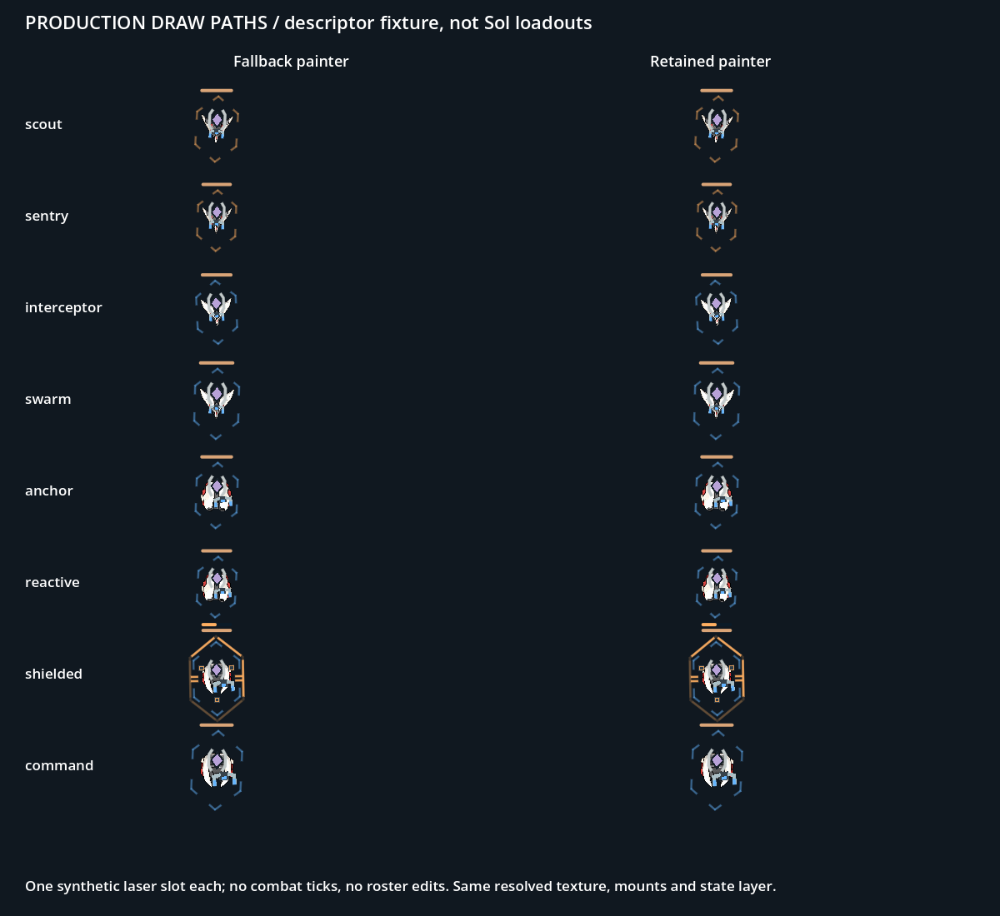

# 候选接通：共享身份与描述

父准许的四个候选已接入本表现分支，尚未合并main。映射见[README](README.md)；这里只记录实现证据与未完成项。

`enemy_visual_identity.gd`按archetype_id与armourType解析；不从数字ID/size猜新身份，不以shieldType替代舰体类别。空archetype保持旧键；未知原型、装甲不匹配、候选资源不可用回退旧键并按原因记录一次诊断。新增掉落行只要archetype/装甲匹配即沿用外观。

主线程加载时记录asset_ready并沿既有流程统一重定原点/挂点。simulation_geometry_authority.prepare只捕获可用描述；模拟侧解析不进行文件/纹理访问。ship_key随不可变appearance、出生display_descriptor、simulation_geometry_view及死亡冻结描述传播，retained/fallback、状态条边界和原有几何派生取同一键。预热覆盖全部enemy_描述。没有新增几何算法、帧级纹理扫描或kernel战斗字段。

双横肋/菱形在既有draw_protection里绘制，仅前三关opening_readability路径启用；alive且shield>0才显示。恢复仍用现有真实盾量增长/暂停规则，包络和盾数值不变。生产资产仅四张；两张未使用的材质比较稿不注册运行键。

验证：隔离Godot4.6.3导入成功；binding_check.gd完成92项检查，输出[binding-check.json](binding-check.json)。检查八个映射、不同掉落ID、主线程捕获纹理身份、几何包络、出生描述往返、retained旧路径、状态条边界和三类诊断回退。两条生产绘制均实际调用；合成夹具每舰一个laser_mon、shielded额外提供有效盾状态，不加入game.enemies，不推进战斗、不写存档。图片不是Sol装备表或真实18点验收。

生命周期补证及asset_ready兼容修正见[LIFECYCLE_EVIDENCE.md](LIFECYCLE_EVIDENCE.md)。已只读Sol 6b2e98da的装备/尺寸：40行归为八种单武器组合；四武器U压力稿不是该版本实际配置。该对照暴露的重复攻击甲板已在新资产路径收敛，见[同尺度对照与13敌短片](deck-readability/README.md)；真实武器、挂点、组件尺度保持。Windows原生执行/性能未在本环境验收，槽位仍由父/Sol协调。

复现：在隔离导入项目中，以Godot --path <project> --rendering-method gl_compatibility --audio-driver Dummy --script res://docs/art/opening-three/defence-candidates/binding_check.gd运行。预期三条回退warning与OPENING_BINDING_CHECK_OK 92，无SCRIPT ERROR。
