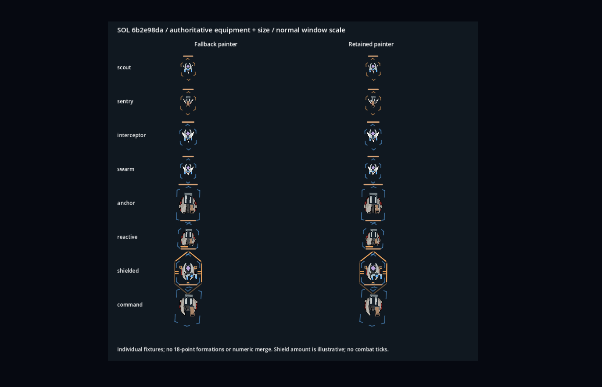

# 最小生命周期补证

生产改动仅simulation_geometry_authority.prepare的一处缺省值：没有asset_ready标记时保留旧纹理捕获，显式false仍跳过。旧/隔离owner不必新增该字段才可准备旧资源。候选解析仍要求明确asset_ready=true，不会因此把未知候选自动启用；所有纹理读取仍在prepare主线程边界。

只走一条流程：slot=0的shielded死亡，slot=0新uid的scout出生，并保留旧实例引用。随后交还显示所有权，消费旧/新爆炸事件。未推进战斗、未启动新档实玩、未扩武器矩阵。

- [完整原始日志](lifecycle-final.log)：33项检查通过，无SCRIPT ERROR/ERROR；含实际Godot版本、预期回退warning、状态条矩形和读取的装备/尺寸。
- 核查纹理、挂点、状态条不会沿slot串用；旧舰有盾、新舰无盾，盾条/有效状态不会继承；旧实例冻结描述与新出生描述各保留ship_key。实际Runtime.install/close的provider交接前、发布后、交还后都有该键。**未运行原生kernel**，不能替代Windows所有权/性能验收。
- 当前battlefield/native适配器使用带uid seed的程序化击毁，没有舰体纹理碎片；已核旧事件仍指旧uid。旧main基础分支的六片纹理碎片另行消费真实on_event：旧事件晚到仍取旧纹理，新事件取新纹理，已生成的旧片不会换壳。
- 无标记owner仍捕获enemy_1至enemy_6；显式不可用描述不捕获。未知archetype、缺ship key、资源不可用、装甲不匹配均回退旧键。

检索到的现有test_fleet_pose_cache.gd直接构造authority、只使用舰队姿态，不调用prepare；已有性能driver通过正常场景Runtime.install准备。此处补的是隔离/旧owner兼容，不宣称现有全部测试受损或已全量通过。

## Sol权威装备/尺寸对照

远端确认并只读`6b2e98da382ac3903a0474936119a2dea59d4cb6`的game_data.json，提取[authoritative-loadouts.json](authoritative-loadouts.json)：仅id/archetype_id/size/equipment，没有合并其数值、奖励或战点。40行按archetype归为八种一致组合，均一个武器；新增掉落行保持原型外观。

1373×883窗口、1952×1256逻辑画布；单舰夹具可见高度约20.8–44.0px。scout/swarm最小，shielded为size3单激光、command为size5单物理炮。盾量为状态示意；未加载18点编队数量/位置或推进战斗，因此不是完整关卡截图或阵型碰撞验收。现有中央攻击甲板在这些真实装备/尺寸下仍遮盖防御大面，不能以33项生命周期检查或前轮92项接口检查声称可读性通过。下一步应优先对获准新舰体收敛该装饰层，并保持真实武器、挂点与弹体不变。

复现：在隔离导入项目运行 `godot --path <project> --rendering-method gl_compatibility --audio-driver Dummy --script res://docs/art/opening-three/defence-candidates/lifecycle_check.gd`；未过滤的原始输出保存在lifecycle-final.log。需先具备本目录authoritative-loadouts.json。原生环境仍由父/Sol协调。
