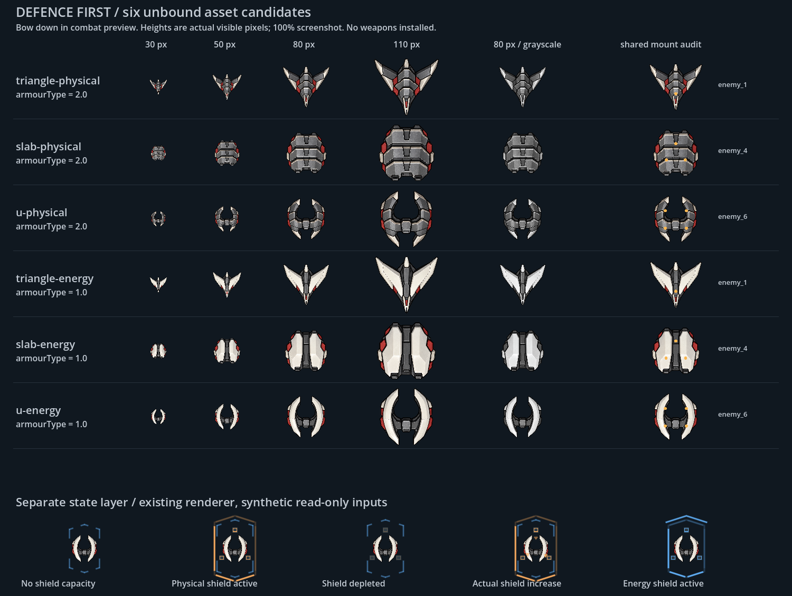

# 防御优先：三族 × 两种装甲材质候选

本轮仅新增待审资产、离线准备/审稿脚本和证据；未改生产代码、背景、敌人行或战点。旧[共享ship_key提案](../binding-proposal/README.md)保留，八种小灯片变体撤回。six-hulls源图由ImageGen基于R03轮廓制作，不是Blender模型；prepare.py仅连通域提取、等比缩放与透明画布规范化。

## 识别契约

| 数据 | 视觉责任 | 不应混淆 |
|---|---|---|
| armourType=2 | 三族共用横向宽厚叠甲、深横缝、金属倒角 | 不是攻击类型，也不代表绝对物理免疫 |
| armourType=1 | 三族共用连续浅色陶瓷纵面、深色中槽 | 不是护盾；无盾/破盾后材质仍在 |
| shieldType | 现有独立盾层的类别信号 | 不据此改装甲材质；hit.type是攻击类型 |
| max_shield / shield | 无容量、有效、耗尽三个事实状态 | 耗尽时不保留完整有效盾轮廓 |
| 实际盾量增长 | 现有回流表现 | 不把计时器到期视为已经恢复 |
| 真实装备/机制反馈 | 炮口与命中等短时反馈，次于稳定防御识别 | 不编造蓄力窗口、免伤分项或同轮批次 |

橙/蓝仅辅助；装甲通过大面方向和材质明暗区分。护盾状态栏直接调用当前enemy_recognition_visual.gd，采用合成只读输入，不是战斗录像，也未新增盾类别规则。当前盾类别在小尺寸仍较依赖颜色，不能据此宣称全部防御类型已完成非颜色识别；下轮应先审类别形状信号，再沿既有发布/绘制路径实现。

## 资产规格与共享挂点

- hulls内六张均887×1774 RGBA、舰首朝上，导出时不烘焙武器或护盾；审稿图旋转180°。实际舰体长边720px，短边等比，画布四边留透明区。生成源的实体alpha约253/255，边缘抗锯齿保留；透明区RGB已清零。
- 源提示：三列三角/宽板/开放U、两排横叠金属/纵向陶瓷，正交俯视、舰首朝上、下右照明、石墨与暗红敌方框架、无武器/文字/背景/发光；第二次清理背景。结果由prepare.py可重建。源图中U族两端尖角偏强，朝向辨识弱于三角，仍是待修候选。
- candidates.json的enabled=false。三角临时对照enemy_1、宽板enemy_4、U形enemy_6；同族两材质逐字段复制同一现有hardpoints/slot_map，仅供审查，不是敌人绑定、不代表实际装备数量。
- 六图挂点**中心**均落在alpha内（0.984–0.996），不等于完整武器/转角包络通过。没有移动挂点，也未为好看另造炮口。

## 几何审查结论：不能直接替换

review.gd调用既有hull_profile → alpha_boundary → convex_hull；未改算法。geometry-audit.json记录每张候选完整profile、旧bounds、挂点采样和360方向支撑差。比较坐标均为既有画布宽度归一化，非屏幕像素/伤害距离。

| 族 | 对照旧资源 | 最大轮廓支撑差（物理 / 能量） |
|---|---|---|
| 三角 | enemy_1 | 0.2295 / 0.2285 |
| 宽板 | enemy_4 | 0.1831 / 0.1883 |
| U | enemy_6 | 0.3522 / 0.3464 |

新舰体更紧凑，不能承诺旧碰撞/缩放等价；同族两材质的alpha也并非逐像素相同。U形中央透明区被现有凸包覆盖，不能承诺弹体可穿过。下一步应先收敛同族共用alpha和轮廓尺度，完成真实装备包络/落点审查，再由父决定统一ship_key接入；不得单独给新图套不一致的旧碰撞。

验证：隔离副本Godot4.6.3 / gl_compatibility / Mesa llvmpipe成功渲染review.png并生成审计。直接源图加载仅用于离线脚本，不是导出加载方案。未做Windows原生性能验收，未启动新档实玩或平衡测试。

复现（在隔离项目中）：先python prepare.py，再以Godot --path <project> --rendering-method gl_compatibility --audio-driver Dummy --script res://docs/art/opening-three/defence-candidates/review.gd运行。文档目录不进入生产资源清单。
