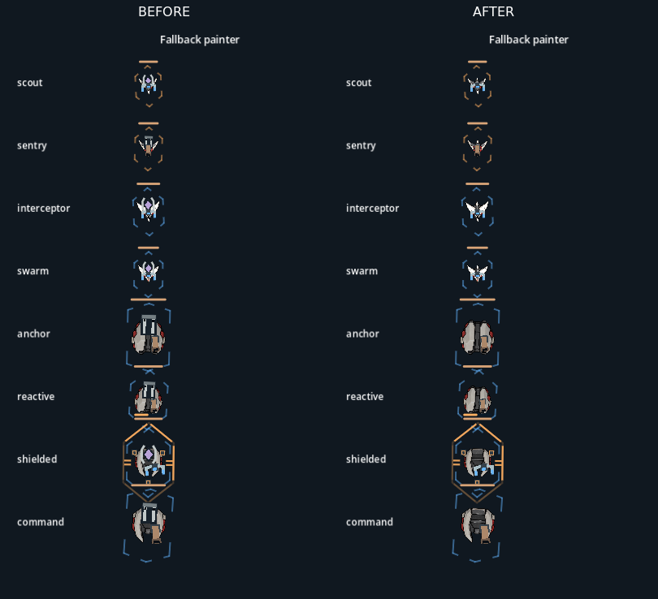

# 新舰体重复攻击甲板收敛

[13敌编队前后短片](formation-before-after.mp4) · [完整修改后画面](formation-after-t121.png) · [修改前两绘制路径](single-before.png) · [修改后两绘制路径](single-after.png)

生产改动仅三处绘制文件：main的enemy_attack_deck_visible根据已经解析的ship_key判断；enemy_opening_资产不再叠加旧draw_attack_deck装饰，fallback/base painter和retained deck组共同遵守。旧资产仍显示原装饰。真实武器组件、数量、尺寸、挂点、炮口、发射路径、舰体alpha、既有保守几何包络均未变；未修改资产或重绘背景。

结果：宽板舰两侧浅陶瓷甲面、U族前叉和尾桥不再被额外枪形/紫色菱形甲板盖住。图中仍可见的炮台/能量器是实际equipment对应组件，没有删除或缩小。约21px的小舰依然小，本次不以放大素材替代实际尺度判断。

## 实际编队取样

Sol `6b2e98da382ac3903a0474936119a2dea59d4cb6`第2关第5点，group33010，实际13敌（十二蜂群加一厚舰）。通过现有checkpoint API进入，保留原slots、装备、尺寸和数值；临时profile只打开第2关访问门槛，使用默认玩家装备，不写存档。录制前后都使用相同数据和种子51015，180个1/60秒逻辑步、每3步取一帧；3秒期间13敌持续存活。

两次[capture记录](before-capture.json)与[修改后记录](after-capture.json)逐字段完全相等：[comparison.json](comparison.json)。64次发射的serial/阵营/挂点/位置、逐帧敌人数/弹体数、最终敌人/弹体/距离/RNG均一致；每次截图前后也检查战斗状态不变。原始日志：[前](before.log)、[后](after.log)，无脚本错误。上述为本片段证据，不外推为所有机制验收。

短片将两段实际画面的战场区原像素裁切并排，不缩放舰体、不删弹体；20fps仅是视频采样率，游戏仍按1/60秒步进。完整1373×883截图保留HUD与装备栏。Godot4.6.3/Mesa llvmpipe软件渲染，不作Windows原生帧率验收；未运行原生kernel，也没有完整18点验证。

## 复现边界

使用隔离项目与readability_capture.gd。数据仅在临时副本覆盖为Sol同提交的data/game_data.json及匹配的scripts/hyperspace_config.gd、scripts/hyperspace_reward_binding.gd；这两个读取器用于兼容该数据的奖励引用包，未提交到表现分支，录制后已还原临时副本。最初仅覆盖JSON会被旧读取器拒绝，不能跳过校验。

修改前采用4e930a3c的main/battlefield/retained_enemy_contacts，修改后采用本提交；其他文件一致。设置OPENING_DECK_OUTPUT=<输出目录>，运行 `godot --path <隔离项目> --rendering-method gl_compatibility --audio-driver Dummy --script res://docs/art/opening-three/defence-candidates/readability_capture.gd`。输出frames仅为临时素材，不入Git；交付保留短片、关键帧、对照和原始日志。
