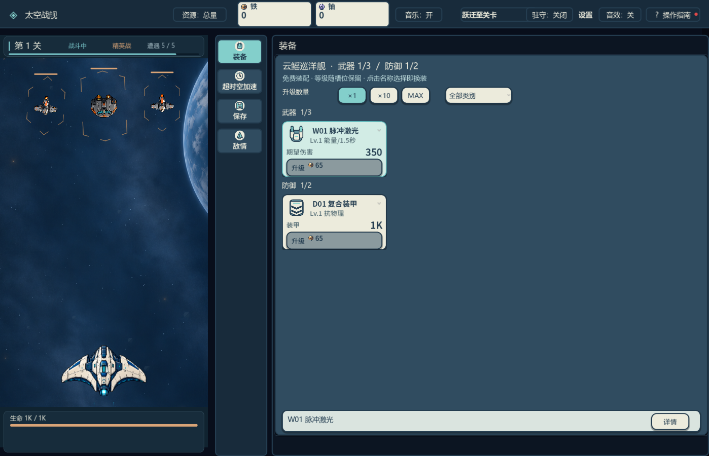
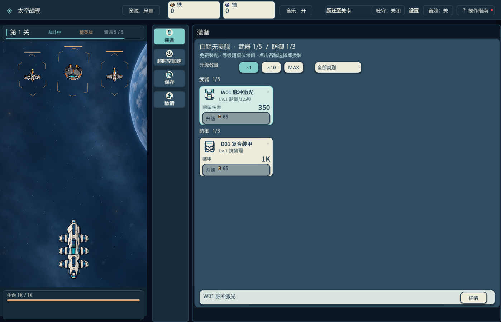
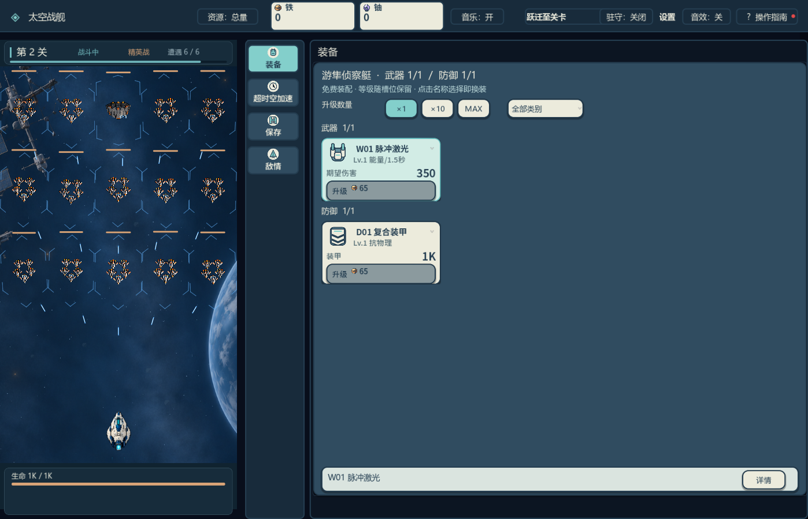
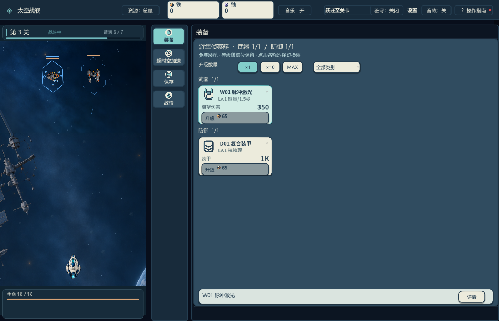
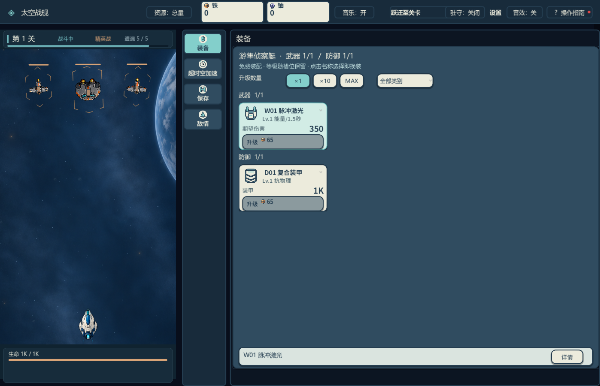
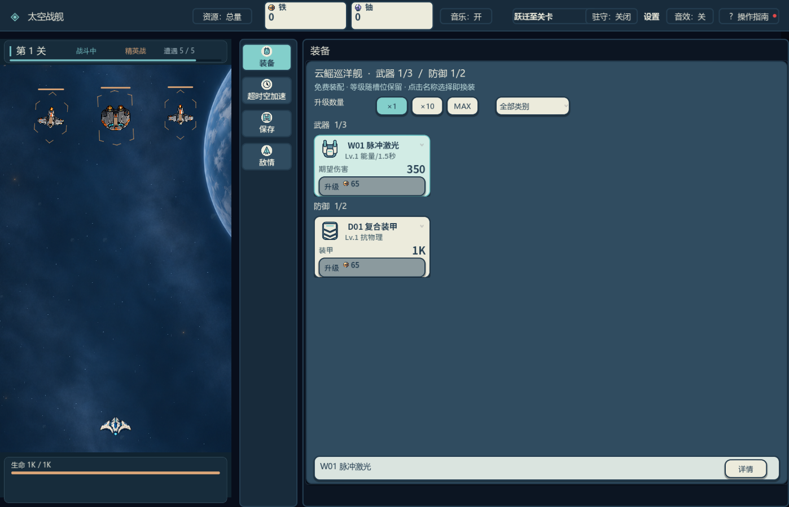
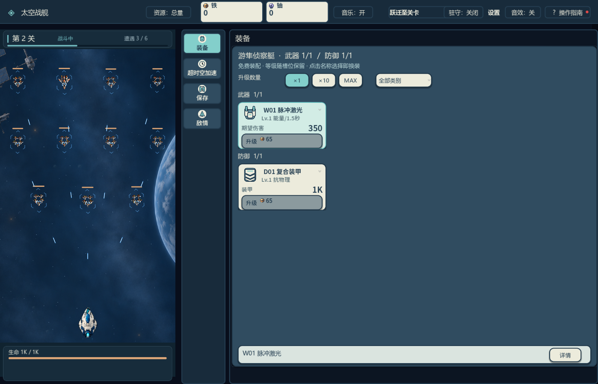
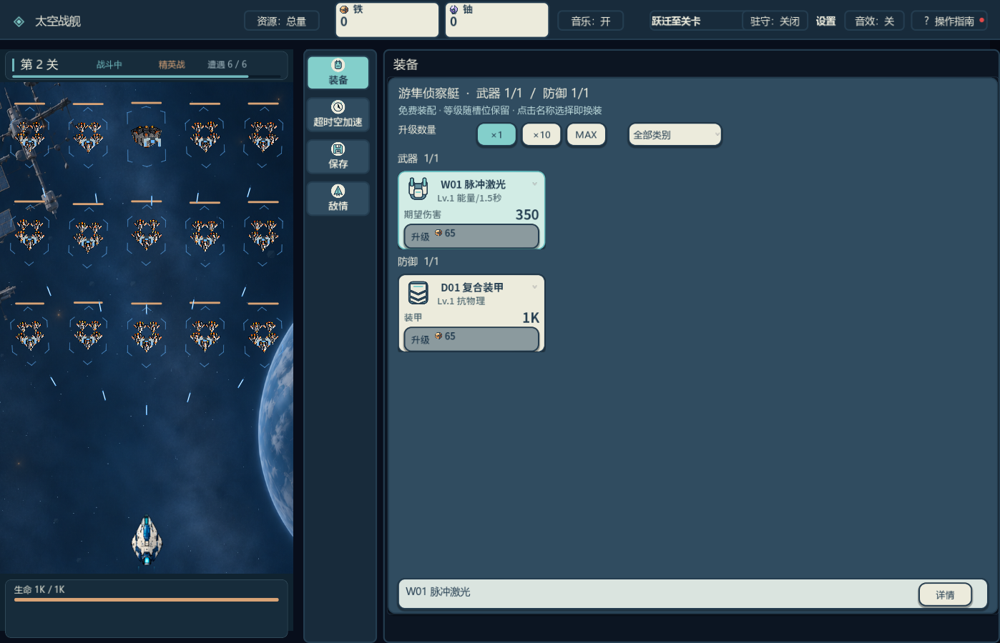

# Fleet battle review index

## Current candidate: main51 geometry, approved PNG display

One automatic Godot 4.7.2 capture, 1398×900, speed 1, native combat presentation. [Capture log](evidence/main51-split-capture.log) records all eight enemy archetypes across the five encounter images, five live player textures, retained muzzle assertions, and `FLEET_CAPTURE_DONE 11`. [Ship selection UI](evidence/main51-split-review/ship-ui-five.png) is separate from the battle captures. These original images are for parent visual review.

| Live player hull | Current battle screenshot |
| --- | --- |
| Frigate |  |
| Destroyer |  |
| Cruiser |  |
| Battleship |  |
| Heavy Battleship |  |

| Enemy encounter | Current battle screenshot |
| --- | --- |
| Scout and sentry |  |
| Swarm and interceptor |  |
| Swarm and anchor |  |
| Reactive and shielded |  |
| Command and shielded |  |

## Superseded capture

One automatic Godot 4.7.2 capture, 1398×900, native combat presentation, speed 1. The ten battle screenshots below are full original files. They precede the later player safe-area fit and 0.45 enemy turret display multiplier, so they are diagnostic evidence rather than approval images for the current code. [Capture log](evidence/final-review-capture.log) records live player texture paths, five enemy combinations, retained weapon muzzle checks, and repeat `set_hull()` cache checks. [Ship selection UI](evidence/final-review/ship-ui-five.png) is separate from the five live player battles.

| Live player hull | Battle screenshot |
| --- | --- |
| 01 Frigate |  |
| 02 Destroyer |  |
| 03 Cruiser |  |
| 04 Battleship |  |
| 05 Heavy Battleship |  |

| Enemy encounter | Battle screenshot |
| --- | --- |
| Stage 1 scout and sentry |  |
| Stage 2 swarm and interceptor |  |
| Stage 2 swarm and anchor |  |
| Stage 3 reactive and shielded |  |
| Stage 3 command and shielded |  |

These are review evidence, not visual approval. The images contain no combat or DLL modifications.
