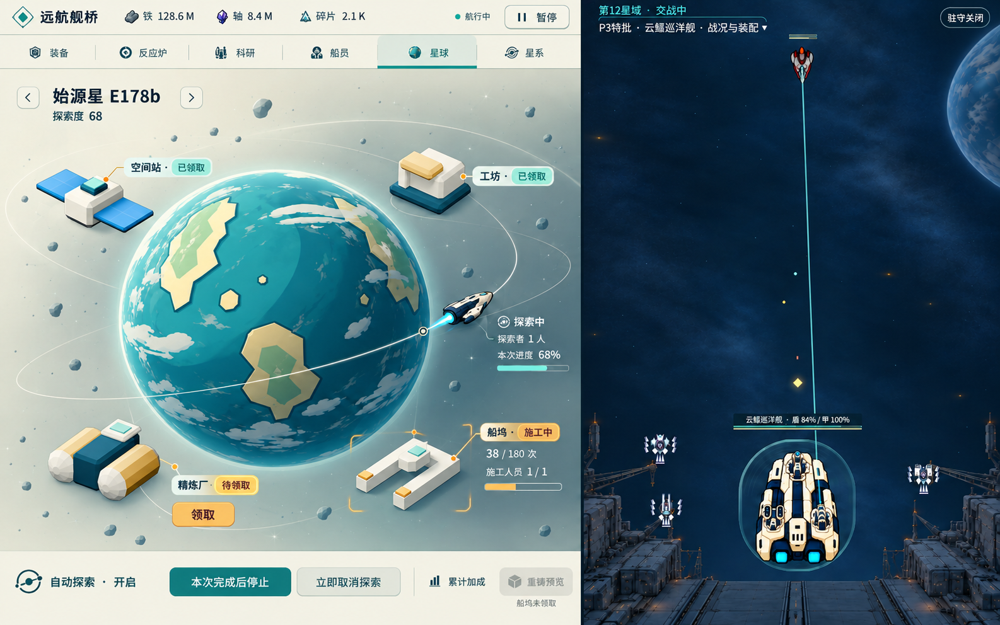

# 星球模块图稿候选 P1

从[唯一入口](../../game-design/README.md)进入；本目录只供独立审查及用户确认。基线 `main@e93c221239a10d377b2ca89dd395ebcfa99c9819`。无 UI 实施、HTML/SVG 样稿、玩法/配置改动或 main 合并。

原图由 `image_gen.imagegen` 生成，未缩放、裁切或后期改图。共用规范仅引用[共享分支 bf359c0d 的13 §2.1及§2.1.1](https://github.com/rlmclmc2-boop/space_idle/blob/bf359c0d9073e064f71028958a21a649b3951875/space-battleship/docs/game-design/13-art-interaction.md#21-专属资产统领构图与观看)，由装备组维护。

目标画布是**待用户确认**的 1440×900 客户区、左侧 808×900 模块区、固定右侧战场；不是 main 当前尺寸，也不改变战斗逻辑边界。生成原图实际为 **1586×992**，模块分界约 x=921，等比映射至1440宽约836px，比目标808多28px。第二轮已明确请求修正，模型仍保留该偏差；本候选不能记为精确比例通过。未用代码拼图或图像修改绕过 image 流程。

左侧全部可用区域构成同一轨道场景：星球、航迹、探索机和四类设施共享空间，操作与状态通过邻近读数和引线归属设施。浅暖边缘操作台接入连续场景，场景本身无内嵌球体框或设施卡片列表。画面只放当前判断信息，没有设计说明和常驻教学。

- [设计、状态与契约边界](design.md)
- [来源和历史实机证据](sources.md)
- [生成请求及文件校验](provenance.json)

尚未通过独立审查或用户确认，不启动实现。本图不是实机证据，也不证明 V0/V7、自然开放流程、动画或操作正确。
