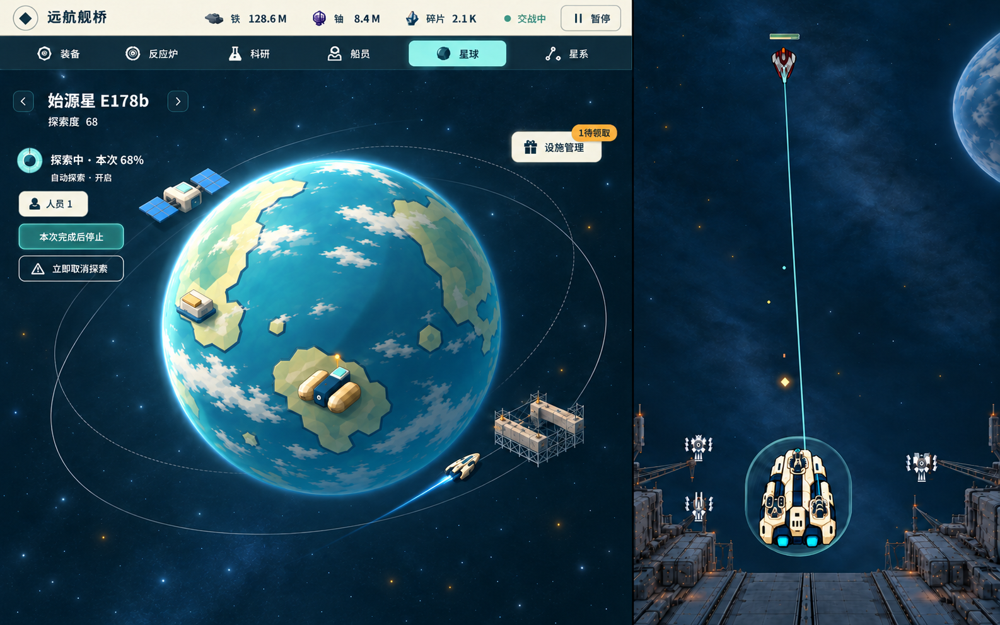

# 星球图稿 P4：默认观看与按需抽屉

[唯一入口](../../game-design/README.md) → [M7候选规范](../../game-design/art/modules/planet.md)。用户要求优先利用圆形星球两侧余量，设施低频管理用抽屉；P3常驻大底部控制区不再沿用。**本轮图像待原独审和用户确认**，不实施UI或合main。

[默认观看态原图](default-watch.png) · [抽屉展开态原图](facility-drawer.png) · [生成前比例/取舍](layout-tradeoffs.md) · [来源/自查](review-notes.md) · [原始请求](generation-requests.json) · [尺寸/哈希](manifest.json)

默认态移除整片底部控制台和常驻设施表：左侧圆外余量放当前探索、人员、自动及停止/取消，右上只留“设施管理／1待领取”。下缘归还轨道空间，不给收起的管理区留空。展开态只显示当前精炼厂的待领详情及领取，累计加成/重铸收进抽屉，不再列四设施大表。代价是设施管理先展开一次；待领入口仍可发现。

两图是同一示例状态的开合设计：D68、本次68%、探索者1人、自动开启；空间站/工坊built、精炼厂ready且施工5/5、船坞38/180和额外人员1/1。未执行领取或时间推进。建筑继续纯观看，精炼厂贴地、空间站独立轨道；工坊地表及船坞近轨仍是建议，未由用户选定。

两次image_gen输出均已实际查看，PNG原始字节归档，**没有额外压缩、缩放、裁切或拼接**。两图均1586×992，实际模块分界约x1002，映射至1440宽约910px，仍未达到808目标；抽屉实际约260×378原生像素（映射约236×343），大于生成前拟定的210–230×240–280预算。原图如实交审，不宣称精确比例、运动净空或V0/V7通过。全轨道/抵达包络尚无运行核验，不能从静帧断言控件永不遮交通。
