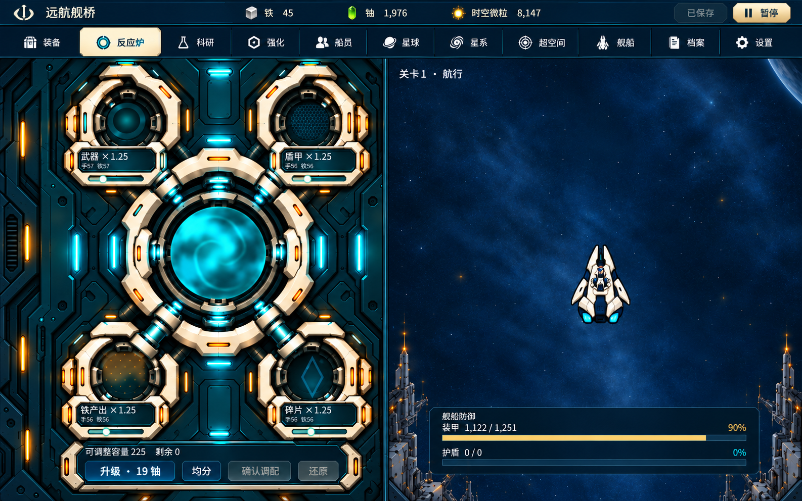

# 共享宿主整体设计候选 H1

状态：设计提案，待根审、原独审和用户确认。未改运行代码，未合 main。规范从 [game-design/README.md](../../game-design/README.md) 进入，仅取13的2.0–2.3、V0，14的宿主相关展示/输入边界及现行运行入口。模块内部仍归各模块组；本任务不替代全系统前端深化。

[整屏设计图 H1](host-h1-topnav.png) · [精确区域示意](regions.svg) · [版本/来源清单](manifest.json)

整屏图用于看宿主气质、入口和场景连贯性；区域示意是本提案的精确坐标依据。生成图的梁高/分界比例仍有偏差，不能按图像像素直接装配。图中被退回的反应炉内部仍待原组替换，未作为新认可成稿；舰船/背景/图标仍须接回既有确认资产。收起/恢复目前仅有行为约定，尚无匹配状态图，因此不将H1标记为完整可实施定稿。

## 现场与版本

复用 `/workspace/space_idle`，候选分支 `design/shared-host-shell`，设计核对基线 `implement/reactor-centered-godot@e77b572b91006f40853af18ba7f7ddb06a894b98`。进入环境时为干净的 `work@e93c2212`；该主线快照不是模块集成版。装备 `5b4f7233` 已由用户冻结，正在按 `25abaade` 图稿重选方向；星球 `a91f65b4` 仍在视觉返工。H1不把这些候选当已通过模块或集成结果。

已收到并快进接纳交接 `158851077d77270f0a104dbeee3746adf746b578`：只有文档与证据更新，`main.gd` 无未提交WIP，运行代码仍沿e77。共享宿主自此由整体线程唯一维护。交接明确r16厚框/贴边/巨缝/标签混乱已退回，反应炉内部效果稿由原组重做；本稿中的旧设备仅是宿主构图占位，不继承其视觉认可。

本环境只有系统 Godot4.6.3，仓库运行记录要求4.7.2/native和图形环境。此次没有重建运行器、独立复测或生成所谓“新运行截图”；下列真实整屏来自候选仓库的已留存取证，设计图是提案，身份分开。

## 已核对的整屏问题

| 位置 | 代码与真实画面 | 问题 |
|---|---|---|
| 顶部模块按钮 | `main.gd::_register_left_module`，x410起、y52；[r16四设备真实整屏](../../verification/reactor-centered-godot/evidence/reactor-visual-r16-four-active-t0.png) | 装备/反应炉按钮越过65px模块标题梁，进入上方设备；导航按装备副标题净空安排，不能跨模块复用。 |
| 舰桥入口 | `main.gd::_setup_growth_panel`，x678/y48；[装备真实整屏](../../verification/reactor-centered-godot/evidence/nav-e5cbbb33-equipment.png) | “舰桥面板”再打开独立548px宽面板、关闭按钮和六页TabContainer，形成第二套导航/外框。 |
| 模块安装面 | `reactor_stage.gd`，源图1024×1536，比例0.6，原点(96.8,20) | 主体宽614.4，而宿主分配808；两侧各约97px纯色。设备和控制台已有共同坐标，不能单移贴图填满而丢失控件对位。 |
| 资源归属 | 装备标题资源、战场HUD余额框与模块内费用 | 全局钱包位置随页面变化且重复；费用仍应留在动作附近，全局余额由宿主统一承载。 |
| 战场 | `main.gd::_show_session`：逻辑572×960置于632×900容器，等比0.9375 | 当前局部视口/拾取路径已独立。整屏调整不能修改逻辑尺寸、船体/炮口/碰撞，不能另消费伤害回执。 |

r16证据含公开接口临时开放、注入预算，不证明自然开放/收入；旧装备证据含教程覆盖。两图只用来核宿主问题，不把它们包装成相同进度对照或本方案验收。

## H1：顶部双梁、单一工作舱、持续战场

设计主题为“舰内工作舱 + 同屏航行视窗”。顶部第一行管理全局资源和真实会话状态，第二行放全部模块入口；不再在设备场景内放导航。海军蓝梁以象牙白文字/装甲饰边承托，青色只强调当前选中和实际能源。模块设备仍是观看主体；此稿不重设计任何模块内部。

1440×900为提案主画布。尺寸待根审、原独审与用户确认；通用接入约定见[13§2.4](../../game-design/13-art-interaction.md#24-共享宿主与模块安装约定设计期)，通知与生命周期见[14§6.1](../../game-design/14-ui-contracts.md#61-共享宿主的最小呈现交接设计期)，各组只引用这两个规范位置。

| 区域 | H1提案矩形 | 职责 |
|---|---|---|
| 全局资源梁 | (0,0,1440,40) | 品牌、唯一全局余额、真实保存状态、唯一用户暂停入口。暂停/故障/教程状态不能被“航行”字样替代。 |
| 顶部模块入口梁 | (0,40,1440,40) | 图标+中文：装备、反应炉、科研、强化、船员、星球、星系、超空间、舰船、档案、设置。其余航程/属性/通知入口放对应具名菜单，仍可达。反应炉示意高亮，最多一个当前项。 |
| 模块安装区域 | (0,80,656,820) | 模块背景填满区域；默认安全内区(16,96,624,788)，主体和全部操作留在内区。装饰/环境可延展到槽边，交互不贴边。模块不再画全局标题/导航/钱包。 |
| 唯一结构接缝 | (656,80,16,820) | 轻薄连续舱壁，统一承托两侧；不叠加模块外框。 |
| 持续战场 | (672,80,768,820) | 顶部航程状态、底部盾甲HUD，中间持续战斗。背景按原来源延展填充，侧边不填黑条。 |

战场显示映射提案：逻辑572×960完整等比放入768×820，比例820/960=0.8541667，显示488.583×820，左上(811.708,80)。此变化只发生于新版宿主安装，不随模块切换、更多菜单或收起再次改变。显示比例不改变逻辑宽高、船体/武器/碰撞/炮口。背景延展单列为表现策略；不把宽背景当成更宽逻辑战场。图稿不证明舰体层级、全装配包络与密集敌阵净空通过，后续须由战场负责人对同版真实整屏复核。

反应炉现有底板/控件/效果必须由原组在上述槽内重新给出共同装配和安全区，避免把808×900旧Control盲裁或非等比压缩。现有614.4px宽主体只能说明可评估的资源边界，不能自动证明624×788安全区装得下完整操作台。原组正在重做内部图，本线程只交槽位、内距、背景和导航约束，不决定其核心/设备/读数布局。装备和星球同理；内部不满足安全区时由双方明确调整候选区域或内部装配，不能静默裁控件。

图稿是宿主视觉方向，旧设备占位与数值只沿用来源截图；图像生成可能调整材质、字形或主体，不能作为原资产几何、尺寸或内部品质的接受凭据。实际安装以本表、各组安全区及后续同版真实画面为准。

## 视觉与切换规则

全局只保留一层结构框。梁/接缝使用同一象牙色 `#ecebdc`、结构蓝 `#243d50`、青色 `#83cfcb`；深色阅读面维持对比。沿用仓库NotoSansSC发布字体；提案导航16px、主体文本16–18px、重要读数20–22px，模块已有较小的精确附值留给所属组评估。正常/禁用、焦点、选中不能只用亮度区别；选中用内凹底座、青色边和中文名共同表达。费用、失败和草稿靠近实际动作；全局保存失败单独持续可达，临时成功提示不占整个工作舱。

顶部导航每次只切换一个活动模块；同一模块不重复构建。切换和收起不提交、不清草稿、不暂停业务，不创建新Session。隐藏视图停无用动画/绘制，重新显示由其所有者处理待失效快照。选择/滚动/视角/焦点仍由模块保存；对象失效、开放集合变化和危险事务按原模块契约使旧预览失效。宿主不代替模块确认或撤销。

“收起工作区”位于模块入口梁末端的紧凑控制，仅隐藏操作内容，保留顶部入口、最后选中入口及完整模块背景的静态环境；不缩放/移动战场，不自动暂停。收起时停该模块工作动画，避免把静态底图误称设备仍在推进。恢复返回原上下文。更多菜单局限在模块侧，不覆盖战场；危险确认维持既有语义，遮罩阻止底层点击，不添加自动暂停。

全局钱包只显示已接入资源，长金额采用所属公开格式化结果及单位，悬停给完整文本；不经float重建Amount。矿产不足仍在费用旁解释。保存“已保存”必须来自现行持久完成状态，排队不能冒充完成。设计示意数值仅沿用来源截图，不承诺自然游戏状态。

## 最小接入规划与模块交接

1. 已固定宿主交接15885107并核对main无额外WIP；后续保持各组内部改动。根审/原独审对同版H1设计图、本文与整屏问题表提出意见；用户确认前不改运行实现。
2. 共享宿主负责主画布、全局梁/钱包、顶部模块入口、模块槽、结构接缝、宿主弹层及焦点/遮挡。复用 `_register_left_module` 的稳定ID与公开开放判断；将六页舰桥入口收敛到同一导航体系，保留原实际操作入口，不恢复已退役系统。
3. 各组交付自身内容根与呈现安装说明：原始画布尺寸、内容可见边界、独立标题/外框可隐藏项、控件/设备安全区、允许背景裁切区、最小可读尺寸、主体锚点和指针归属。它们是前端装配元数据，不加入业务状态，不新增通用DTO/总线。现有方法不足时由相应组确认最小扩展，不读私有字段。
4. 反应炉组保持核心/四路短接/滑杆/控制台同一变换；装备组按用户重选稿提供内容根；星球组在视觉返工结束后提供安装边界。H1不合入装备冻结实现，也不提前批准星球候选。
5. 战场继续单一BattleView消费表现，原逻辑尺寸和共享几何不变。拾取继续由实际SubViewportContainer把事件映射至局部视口后进入EconomyView；额外背景层不接拾取。宿主梁/导航/弹层先消费点击，避免穿透。由原战场负责人审查一次横向平移、顶梁遮挡与HUD余额迁移，不能只凭矩形分析记通过。
6. 统一钱包消费Economy公开余额/变化出口；删除旧HUD/标题内的全局余额重复呈现须与相应消费者一起改，模块费用/预算/预览仍保留。命令结果留在所属模块或既有错误入口，不新增宿主业务解释器。

## 评审与后续证据门槛

当前仅完成源码核查、既有真实整屏阅读和设计提案。未做游戏测试，无V0/模块V项通过声明。

| 门槛 | 所需结果 | 当前状态 |
|---|---|---|
| 宿主WIP交接 | Git固定点、共享文件归属、匹配真实整屏 | 已收到15885107；运行源码沿e77，旧整屏仅作问题依据 |
| 根审 + 原独审 | 同版整屏图：导航不压设备、无重复钱包/外框、主体无盲裁、各模块安装可行、战场映射与输入边界成立 | 待审 |
| 用户确认 | 确认整屏组织、样式、切换和收起效果 | 待确认，未开始实现 |
| 授权后V0 | 同一实现的普通窗口整屏：装备/反应炉/星球/更多/收起与恢复，展开详情/危险确认，真实资源变化、暂停、失败；记录自然/受控状态 | 待后续实施；不自行新建复测框架 |

仅做设计文件的差异检查，不以文档/图稿替代真实游戏验收。文件交接仅用本Git分支及提交，不入Library，不合main。
